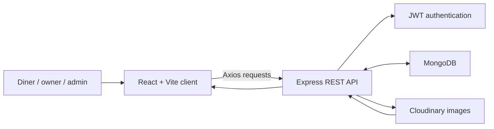
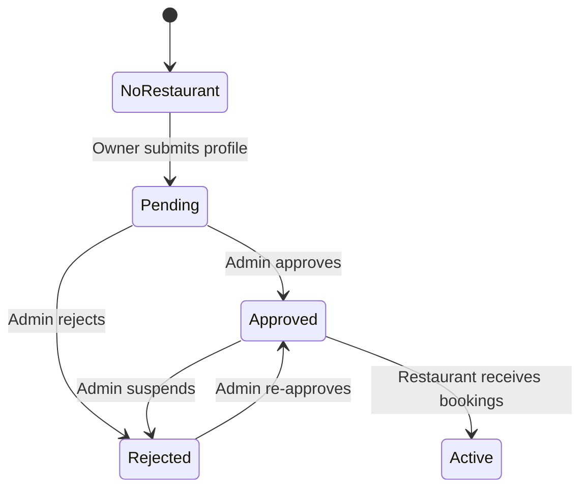

# QuickDine

<p align="center">
  
</p>

<p align="center">
  A full-stack restaurant discovery, table-reservation, owner-management, and administration platform.
</p>

QuickDine helps diners discover restaurants and reserve seats while giving restaurant owners and administrators dedicated tools for managing listings, availability, bookings, and approvals.

The project contains a React single-page application and an Express REST API backed by MongoDB. It supports three roles: diner, restaurant owner, and administrator.

## Visit QuickDine

| Service | Address | Status |
|---|---|---|
| Hosted web application | [quick-dine-jade.vercel.app](https://quick-dine-jade.vercel.app/) | Live production website |
| Web application (local) | `http://localhost:5173` | Available after starting the client |
| API health check (local) | `http://localhost:5000` | Available after starting the server |
| Hosted API | [quickdine-api-d604.onrender.com](https://quickdine-api-d604.onrender.com/health/ready) | Readiness HTTP 200 verified 17 October 2026 |

Visit the live application at [https://quick-dine-jade.vercel.app/](https://quick-dine-jade.vercel.app/). To run the project yourself, follow the [local setup](#run-the-project-locally), start both services, and open `http://localhost:5173` in a browser. Vite may choose a different port if 5173 is already occupied; use the URL printed in the client terminal.

## Features

### For visitors and diners

- Browse featured and exclusive restaurants.
- Search restaurants by keyword and location.
- Filter by cuisine and price range.
- Sort restaurant results by price.
- View restaurant descriptions, cuisine, chef, address, price range, and available dining slots.
- Check remaining seat capacity for a selected date and time.
- Register and sign in with a persistent JWT session.
- Reserve a table for a selected date, time, and party size.
- Add an occasion and special requests to a reservation.
- Receive a unique booking reference after confirmation.
- View upcoming reservations and dining history.
- Cancel an active reservation.
- Browse restaurant recommendations from the dashboard.

### For restaurant owners

- Register an owner account.
- Submit one restaurant profile for administrator approval.
- Upload a restaurant cover image through Cloudinary.
- Configure cuisine, location, address, chef, tags, price range, capacity, and time slots.
- View pending, approved, or rejected registration states.
- Update an approved restaurant profile and capacity.
- Review restaurant bookings with diner details and special requests.
- Mark reservations as confirmed, cancelled, or completed.

### For administrators

- Access a protected administration dashboard.
- Review all restaurant registration requests.
- Approve, reject, suspend, or re-approve restaurants.
- View diner, owner, restaurant, and booking totals.
- Review recent booking activity.

### User experience

- Responsive desktop and mobile layouts.
- Role-aware navigation and protected routes.
- Loading, success, and error feedback.
- URL-based search filters that can be bookmarked or shared.
- SPA routing support for Vercel deployments.

## How the application works



The client uses a same-origin `/api` proxy and cookie authentication. The JWT is stored in an HttpOnly cookie, with Secure enabled in production and SameSite=Lax. Axios sends credentials and obtains a CSRF token for mutations. The server verifies the token and persisted session, reloads the user and role, and applies authorization and validation.

Restaurant images uploaded by owners are held temporarily in memory and streamed to Cloudinary. Listings can also use images served from the client's `public/` directory. Each restaurant's `image` field in MongoDB stores either a Cloudinary URL or a public image path. Restaurant profiles, user accounts, and bookings are stored in MongoDB.

For detailed design documentation, see:

- [Client architecture](client/ARCHITECTURE.md)
- [Server architecture](server/ARCHITECTURE.md)

## Restaurant cover images

Cupstory and Madgrill use generated indoor views as illustrative cover images. These are not verified photographs of the actual venues.

| Restaurant | Cover | Source asset |
|---|---|---|
| Cupstory | Cozy café interior | [cupstory-interior.png](client/public/images/restaurants/cupstory-interior.png) |
| Madgrill | Warm grill restaurant interior | [madgrill-interior.png](client/public/images/restaurants/madgrill-interior.png) |

These images are served at `/images/restaurants/cupstory-interior.png` and `/images/restaurants/madgrill-interior.png`. They are included in the client build and do not require Cloudinary. Cloudinary uploads returned HTTP 403 during this update, so the project-hosted assets were used.

To inspect the two matching database records without changing them, run from the project root after installing server dependencies and configuring `server/.env`:

```bash
cd server
node scripts/update-restaurant-images.mjs
```

Both preview and apply modes require `MONGODB_URI` in `server/.env`. The `--local` mode does not require `CLOUDINARY_URL`. Without `--apply`, the script does not upload images or write database changes.

To apply the project-hosted interior images, continue from `server/`:

```bash
node scripts/update-restaurant-images.mjs --apply --local
```

The script requires exactly one record matching each restaurant's name and slug (`Cupstory` / `cupstory`, `Madgrill` / `madgrill`). It updates only their image fields. It verifies the saved paths after each update. Previous and new values are recorded under `docs/evidence/restaurant-images/`. The script does not create missing restaurants. It does not run the destructive seed script.

For Cloudinary hosting, configure `CLOUDINARY_URL` and run `node scripts/update-restaurant-images.mjs --apply` without `--local`. This uploads the images and saves their Cloudinary URLs instead. It checks that each uploaded URL returns an image before saving it to the database.

After changing project-hosted images, rebuild and deploy the frontend so the hosted website can serve the files. Updating the database alone does not publish new image assets.

## Technology stack

### Client

- React 19
- TypeScript
- Vite
- React Router
- Tailwind CSS 4
- Axios
- React Hot Toast
- Lucide React

### Server

- Node.js
- Express 5
- TypeScript
- MongoDB and Mongoose
- JSON Web Token authentication
- bcrypt password hashing
- Multer file handling
- Cloudinary image storage

### Deployment

- Client and server include Vercel configuration.
- The client supports a configurable API URL through `VITE_PUBLIC_API_URL`.
- The server exports its Express app for a serverless Vercel runtime and starts a regular listener during local development.

## Project structure

```text
QuickDine/
├── client/
│   ├── public/                 # Public logo, favicon, and restaurant images
│   ├── src/
│   │   ├── assets/             # Imported images and static display data
│   │   ├── components/         # Shared and feature-specific UI components
│   │   ├── context/            # Authentication and application context
│   │   ├── lib/                # Configured Axios API client
│   │   ├── pages/              # Public, diner, owner, and admin pages
│   │   ├── App.tsx             # Client route table
│   │   └── main.tsx            # React application bootstrap
│   ├── ARCHITECTURE.md         # Detailed client architecture
│   └── package.json
├── server/
│   ├── config/                 # MongoDB and upload configuration
│   ├── controllers/            # HTTP and business-flow handlers
│   ├── middlewares/            # Authentication and role guards
│   ├── models/                 # User, Restaurant, and Booking schemas
│   ├── routes/                 # REST endpoint declarations
│   ├── scripts/                # Image updates, audits, and development utilities
│   ├── ARCHITECTURE.md         # Detailed server architecture
│   ├── seed.ts                 # Destructive development data seed
│   ├── server.ts               # Express application entry point
│   └── package.json
├── .gitignore
└── README.md
```

## Run the project locally

### Prerequisites

Install or create the following before starting:

- a current Node.js LTS release with npm;
- a MongoDB database, either local or hosted;
- a Cloudinary account for owner image uploads;
- two terminal windows, one for the server and one for the client.

### 1. Clone the repository

```bash
git clone https://github.com/AbdulJulilShahria/Quick-Dine-.git
cd Quick-Dine-
```

If the project is already on your computer, open a terminal in its root directory instead.

### 2. Configure and start the server

Move into the server folder and install its dependencies:

```bash
cd server
npm install
```

Create `server/.env` with your own values:

```dotenv
MONGODB_URI=your_mongodb_connection_string
JWT_SECRET=replace_with_a_random_secret_of_at_least_32_characters
CLOUDINARY_URL=your_cloudinary_connection_url
PORT=5000
```

Do not commit this file or share its secrets.

Start the development server:

```bash
npm run server
```

The API should be available at `http://localhost:5000`, with application endpoints below `http://localhost:5000/api`.

### 3. Configure and start the client

Open a second terminal from the project root:

```bash
cd client
npm install
```

Create or update `client/.env`:

```dotenv
VITE_PUBLIC_API_URL=/api
```

Start the Vite development server:

```bash
npm run dev
```

Open the address printed by Vite, normally [http://localhost:5173](http://localhost:5173).

## Available scripts

### Client scripts

Run these from `client/`:

| Command | Purpose |
|---|---|
| `npm run dev` | Start the Vite development server |
| `npm run build` | Type-check and build the production client |
| `npm run lint` | Run ESLint across the client |
| `npm run preview` | Preview the production build locally |
| `npm test` | Run the client test suite |
| `npm run test:coverage` | Run client tests with coverage |

### Server scripts

Run these from `server/`:

| Command | Purpose |
|---|---|
| `npm run server` / `npm run dev` | Start the API with TSX watch mode |
| `npm start` | Run the compiled API from `dist/server.js` after building |
| `npm run build` | Compile TypeScript into `server/dist/` |
| `npm test` | Build the server and run the Jest suite |
| `npm run test:coverage` | Run server tests with coverage |
| `node scripts/update-restaurant-images.mjs` | Preview Cupstory and Madgrill image updates; see [restaurant cover images](#restaurant-cover-images) for apply options |

## Main application routes

| Web route | Access | Purpose |
|---|---|---|
| `/` | Public | Landing page and featured dining |
| `/search` | Public | Restaurant search and filters |
| `/restaurant/:slug` | Public | Restaurant details and availability |
| `/booking/:slug` | Signed-in users | Booking confirmation |
| `/dashboard` | Signed-in users | Personal reservations and history |
| `/owner/dashboard` | Owners | Restaurant profile and booking management |
| `/admin/dashboard` | Administrators | Approvals and platform analytics |

## API overview

The client uses endpoints under `/api`:

| API area | Base path | Capabilities |
|---|---|---|
| Authentication | `/api/auth` | Register, login, restore current user |
| Restaurants | `/api/restaurants` | Search, featured venues, details, availability |
| Bookings | `/api/bookings` | Create, list, and cancel diner bookings |
| Owner portal | `/api/owner` | Restaurant registration/profile and booking status |
| Administration | `/api/admin` | Restaurant approval and platform statistics |

Protected endpoints require the session cookie issued at login. Mutations also require the `X-CSRF-Token` header obtained from `GET /api/auth/csrf`; the shared frontend API client handles this. Logout uses `POST /api/auth/logout` and revokes the server session.

## User roles and access

| Role | Access |
|---|---|
| `user` | Search, booking, personal dashboard, cancellation |
| `owner` | Diner features plus the owner dashboard and restaurant management |
| `admin` | Diner features plus the administration dashboard |

New users can register as diners or owners. Administrator accounts are not available through public registration.

## Restaurant approval lifecycle



Only approved restaurants appear in public discovery and accept bookings.

## Booking lifecycle

1. A diner selects a restaurant, date, party size, and available time.
2. The protected confirmation page collects the occasion and special requests.
3. The API verifies that the restaurant is approved and enough seats remain.
4. A confirmed booking is stored with a generated `GR-XXXXXXXX` reference.
5. The diner may cancel the booking.
6. The restaurant owner may cancel it or mark it completed.

Only confirmed bookings consume the restaurant's slot capacity.

## Environment variables

### Client

| Variable | Required | Description |
|---|---|---|
| `VITE_PUBLIC_API_URL` | Recommended | Use `/api` for the same-origin proxy, or a full API base URL ending in `/api` |

### Server

| Variable | Required | Description |
|---|---|---|
| `MONGODB_URI` | Yes | MongoDB connection string |
| `JWT_SECRET` | Yes | Secret used to sign and verify login tokens |
| `CLOUDINARY_URL` | Yes for image uploads | Cloudinary account connection URL |
| `PORT` | No | Local API port; defaults to 5000 |
| `NODE_ENV` | No | Controls production error-stack exposure |
| `VERCEL` | Platform-managed | Prevents the app from opening a local listener on Vercel |

## Production builds

Build the client:

```bash
cd client
npm install
npm run build
```

Build the server:

```bash
cd server
npm install
npm run build
```

Use `VITE_PUBLIC_API_URL=/api` and configure a Vercel rewrite to the deployed backend before publishing the client. Configure the server secrets and exact `FRONTEND_ORIGINS` in Render. See [implementation status and measured evidence](docs/IMPLEMENTATION_STATUS.md), [workflow](docs/WORKFLOW.txt), and [literature review](docs/LITERATURE_REVIEW.md).

The [18 October verification supplement](docs/VERIFICATION_RESULTS_2026-10-18.md)
includes owner/admin browser results and hosted measurements, with a
[printable PDF](output/pdf/QuickDine_Verification_Supplement_2026-10-18.pdf).

## Seed script warning

`server/seed.ts` deletes all users, restaurants, and bookings before inserting development data. It must never be run against a production or important database.

The current seed data also contains a duplicate restaurant slug, so review and correct the data before using the script.

## Current limitations

- Reviews, displayed aggregate ratings, newsletter submission, and several footer links are currently static UI content.
- The independent-slot capacity model does not yet account for meal durations or physical table combinations.
- Legacy bookings lack booking-specific contact snapshots; new bookings persist validated contact details.
- The automated suites pass locally and in CI. Diner and owner/admin live checks pass for the recorded workflows. The [18 October evaluation supplement](docs/VERIFICATION_RESULTS_2026-10-18.md) records deployed-data capacity comparisons and paced hosted measurements. Genuine customer provenance remains unknown; these results do not establish pilot adoption or maximum sustainable load.

More implementation risks and recommended improvements are documented in the client and server architecture files.

## Contributing

1. Create a branch for the change.
2. Keep client and server contracts aligned.
3. Run the relevant builds and client lint checks.
4. Never commit `.env` files, database credentials, JWT secrets, or Cloudinary credentials.
5. Open a pull request describing the behavior and verification performed.

## License

This project was developed for educational purposes as part of the Web Programming Lab course at Metropolitan University.
