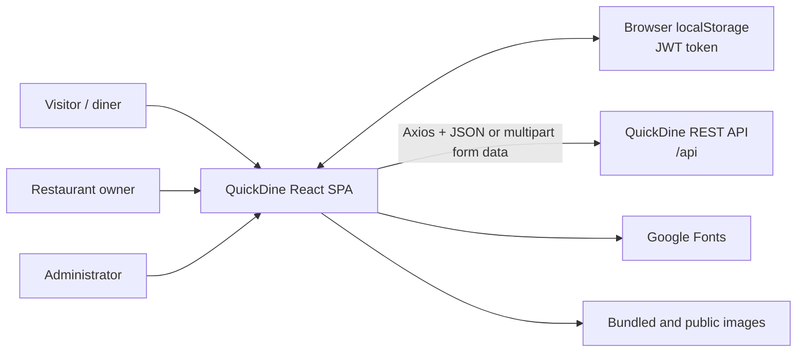
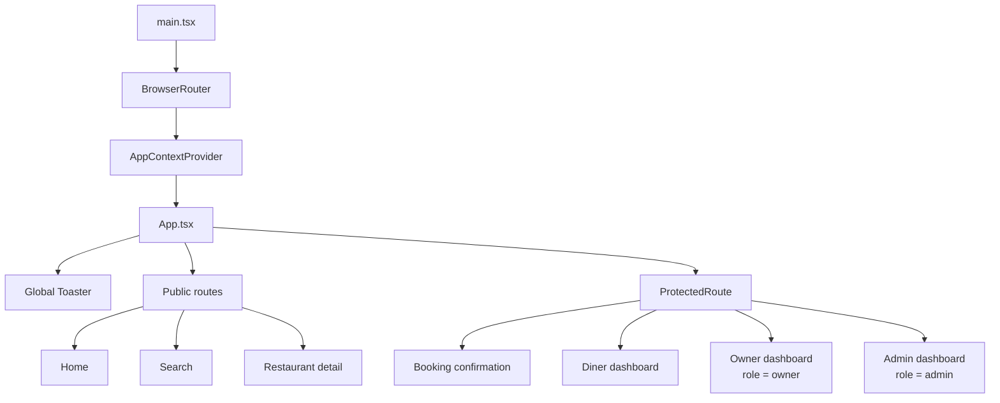
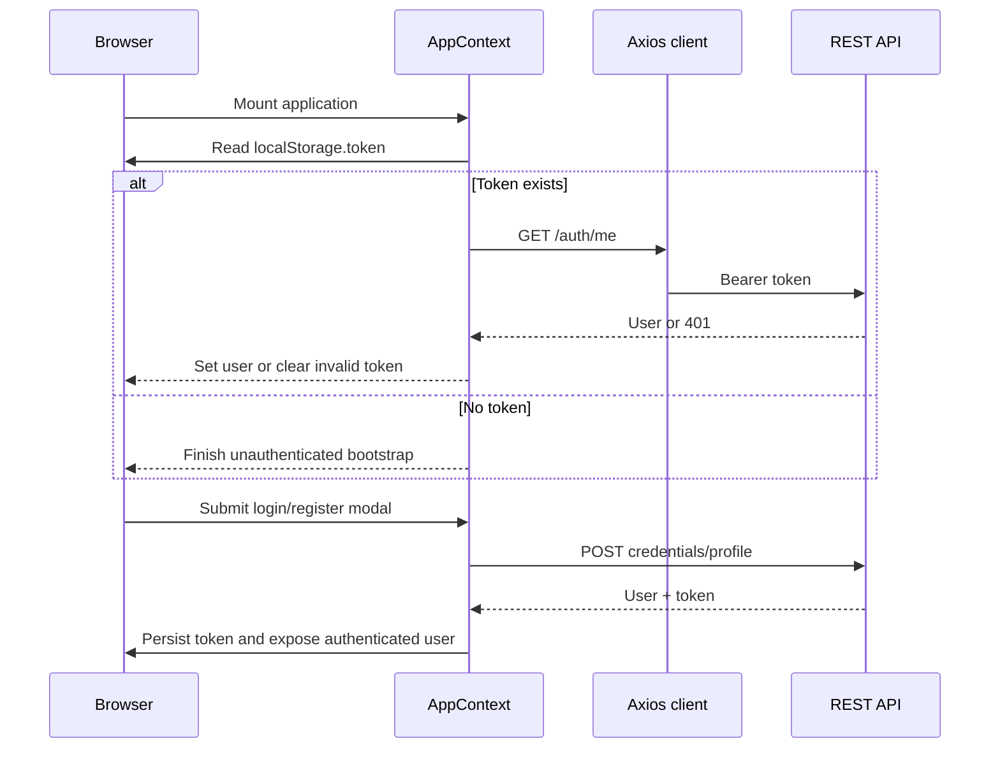
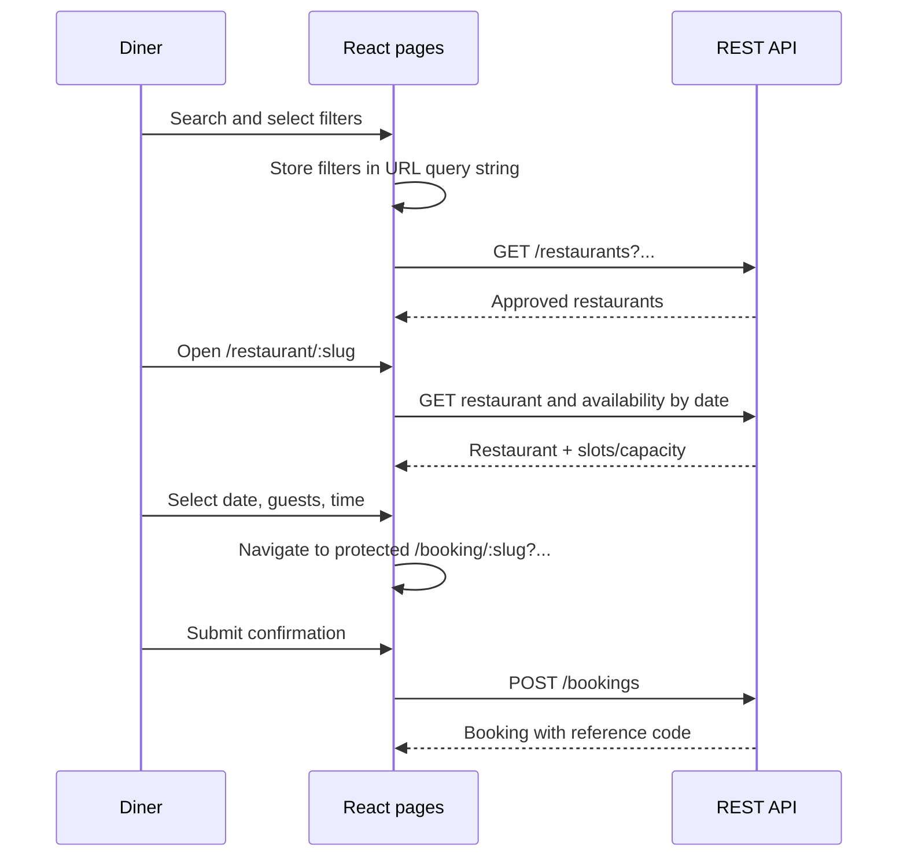
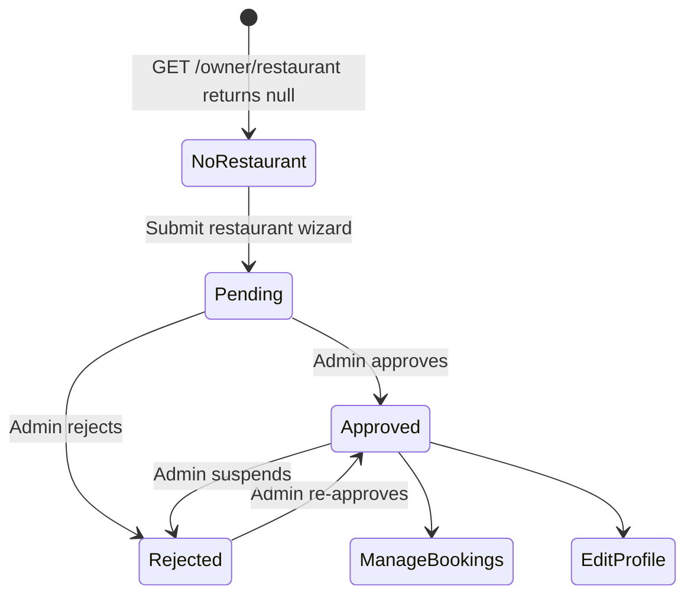

# QuickDine Client Architecture

## 1. Scope and status

This document describes the client as it exists in the repository. It was derived from a scan of all 66 files under `client/`, excluding generated dependency/build directories such as `node_modules/` and `dist/`. Configuration, source code, environment-variable names, lockfile metadata, SVGs, and raster assets were included in the scan.

The client is a single-page restaurant discovery and reservation application. It serves three user experiences from one React application:

- diners discover restaurants, check capacity, create bookings, and manage booking history;
- restaurant owners register one restaurant, wait for approval, maintain its profile, and manage bookings;
- administrators approve restaurants and view platform statistics.

This is an as-is architecture reference. The final section records gaps and recommended improvements without changing application behavior.

## 2. System context



The browser owns rendering, navigation, temporary form state, and authentication persistence. Durable users, restaurants, availability, and bookings belong to the server.

## 3. Runtime and build stack

| Concern | Technology | Responsibility |
|---|---|---|
| UI runtime | React 19 | Functional components, hooks, context |
| Build/dev server | Vite 8 | Development, bundling, environment replacement |
| Language | TypeScript 6 | Static typing and build-time checks |
| Routing | React Router 7 | SPA routes, URL parameters, query-string state |
| Styling | Tailwind CSS 4 | Theme tokens, utilities, responsive layout |
| HTTP | Axios | API base URL, JSON/multipart requests, bearer-token interceptor |
| Feedback | React Hot Toast | Success and error notifications |
| Icons | Lucide React | UI iconography |
| Hosting | Vercel configuration | Rewrites every client route to `/` for SPA fallback |

The app builds with `tsc -b && vite build`. The only client environment variable is `VITE_API_URL`. In development, the fallback API is `http://localhost:5000/api`; the production fallback is hard-coded in `src/lib/api.ts`.

## 4. Source organization

```text
client/
├── public/                    # Directly served logo, favicon, and seed restaurant images
├── src/
│   ├── assets/                # Imported hero/membership/default images, SVGs, static UI data
│   ├── components/
│   │   ├── admin/             # Approval list and platform statistics
│   │   ├── booking/           # Confirmation form, summary, and success state
│   │   ├── home/              # Home-page sections
│   │   ├── owner/             # Restaurant registration/profile and booking management
│   │   ├── restaurant/        # Detail, reviews, and availability widget
│   │   └── *.tsx              # Shared shell, auth, route guard, cards, loader
│   ├── context/               # Global authentication context
│   ├── lib/                   # Configured Axios instance
│   ├── pages/                 # Route-level orchestration components
│   ├── App.tsx                # Route table and global toaster
│   ├── main.tsx               # Browser bootstrap and providers
│   └── index.css              # Tailwind import, theme tokens, global utilities
├── index.html                 # SPA host and external font declarations
├── vite.config.ts             # React and Tailwind plugins
├── tsconfig*.json             # Browser and build-tool TypeScript projects
├── eslint.config.js           # TypeScript/React lint configuration
├── vercel.json                # SPA rewrite
└── package*.json              # Scripts and dependency lock
```

## 5. Application composition



Architectural layers:

1. **Presentation** — reusable components render forms, cards, navigation, status screens, and tables.
2. **Route orchestration** — pages read URL state, fetch remote data, own page-level state, and compose components.
3. **Application state** — `AppContext` owns the authenticated user, token lifecycle, loading state, and authentication modal state.
4. **Infrastructure** — `lib/api.ts` resolves the API URL and injects the bearer token into requests.
5. **Static resources** — `assets.ts`, imported images, `public/` images, global theme CSS, and external fonts.

There is no separate domain/service layer. Pages and some feature components call the Axios client directly.

## 6. Client route map

| Route | Access | Route component | Main responsibility |
|---|---|---|---|
| `/` | Public | `Home` | Featured restaurants, cuisine navigation, marketing sections |
| `/search` | Public | `Search` | URL-driven search, filters, sorting, and result cards |
| `/restaurant/:slug` | Public | `RestaurantDetail` | Restaurant details and date/seat availability |
| `/booking/:slug` | Authenticated | `BookingConfirmation` | Review query-string selection and create a booking |
| `/dashboard` | Authenticated | `Dashboard` | User bookings, cancellation, history, recommendations |
| `/owner/dashboard` | Owner | `OwnerDashboard` | Restaurant onboarding/status/profile/bookings |
| `/admin/dashboard` | Admin | `AdminDashboard` | Restaurant approvals and aggregate statistics |

`ProtectedRoute` waits for authentication bootstrap, displays login UI for anonymous users, and rejects users outside `allowedRoles`. It is a client-side UX boundary; the API remains the security authority.

## 7. State ownership

| State | Owner | Persistence / source |
|---|---|---|
| Current user and auth loading | `AppContextProvider` | Restored with `GET /auth/me` |
| JWT | `AppContextProvider` and Axios interceptor | `localStorage.token` |
| Auth modal and login/register mode | `AppContextProvider` | Memory only |
| Search/filter/sort selection | `Search` | URL query string |
| Restaurant detail and availability | `RestaurantDetail` | API plus page memory |
| Booking selection | `RestaurantDetail` → URL → `BookingConfirmation` | `slug` path plus `slot`, `date`, `guests` query parameters |
| Booking form and result | `BookingConfirmation` | Memory only; result returned by API |
| User bookings/recommendations | `Dashboard` | API plus page memory |
| Owner restaurant/bookings/tab | `OwnerDashboard` | API plus page memory |
| Admin restaurants/stats/tab | `AdminDashboard` | API plus page memory |
| Form fields | Feature components/pages | Local component state |

No general-purpose server-state cache is used. Each page fetches on mount and manually updates or refetches after mutations.

## 8. REST API contract consumed by the client

All paths below are relative to the configured `/api` base URL. Authenticated calls receive `Authorization: Bearer <token>` from the Axios request interceptor.

| Method and path | Access | Client consumer | Purpose |
|---|---|---|---|
| `POST /auth/register` | Public | `AppContext` | Create diner or owner account and receive user + JWT |
| `POST /auth/login` | Public | `AppContext` | Authenticate and receive user + JWT |
| `GET /auth/me` | Token | `AppContext` | Restore current user |
| `GET /restaurants` | Public | `Search` | Search/filter/sort approved restaurants |
| `GET /restaurants/featured` | Public | `Home`, `Dashboard` | Featured/exclusive recommendations |
| `GET /restaurants/:slug` | Public/conditional | Detail and confirmation pages | Fetch one restaurant |
| `GET /restaurants/:id/availability?date=` | Public | `RestaurantDetail` | Seat availability per configured time slot |
| `POST /bookings` | Token | `BookingConfirmation` | Create a confirmed booking |
| `GET /bookings/my` | Token | `Dashboard` | Fetch current user's bookings |
| `PUT /bookings/:id/cancel` | Token | `Dashboard` | Cancel current user's booking |
| `GET /owner/restaurant` | Owner | `OwnerDashboard` | Fetch the owner's single restaurant or `null` |
| `POST /owner/restaurant` | Owner | `RestaurantWizard` | Submit multipart restaurant registration |
| `PUT /owner/restaurant` | Owner | `OwnerProfileDetails` | Update multipart restaurant profile |
| `GET /owner/bookings` | Owner | `OwnerDashboard` | Fetch bookings for the owner's restaurant |
| `PUT /owner/bookings/:id/status` | Owner | `OwnerBookings` | Complete/cancel/confirm a restaurant booking |
| `GET /admin/restaurants` | Admin | `AdminDashboard` | Fetch every restaurant with owner identity |
| `PUT /admin/restaurants/:id/approve` | Admin | `AdminDashboard` | Change approval status |
| `GET /admin/stats` | Admin | `AdminDashboard` | Fetch user/restaurant/booking counts and recent activity |

## 9. Inferred client data shapes

Only the authenticated user and restaurant-card props have explicit reusable interfaces. Most remote data is currently typed as `any`; these shapes describe what the UI actually reads.

```ts
type Role = "user" | "owner" | "admin";

interface User {
  _id: string;
  name: string;
  email: string;
  phone?: string;
  role: Role;
}

interface Restaurant {
  _id: string;
  owner?: User;
  name: string;
  slug: string;
  description: string;
  cuisine: string;
  priceRange: "$" | "$$" | "$$$" | "$$$$";
  location: string;
  address: string;
  image: string;
  chef: string;
  tags: string[];
  availableSlots: string[];
  totalSeats: number;
  featured: boolean;
  exclusive: boolean;
  status: "pending" | "approved" | "rejected";
}

interface Availability {
  time: string;
  availableSeats: number;
  isAvailable: boolean;
}

interface Booking {
  _id: string;
  bookingId: string;
  user: User | string;
  restaurant: Restaurant;
  date: string;
  time: string;
  guests: number;
  occasion?: "Birthday" | "Anniversary" | "Date Night" | "Business Dining";
  specialRequests?: string;
  status: "confirmed" | "cancelled" | "completed";
}
```

## 10. Primary interaction flows

### Authentication bootstrap and login



### Discovery and booking



### Owner lifecycle



## 11. Styling and asset architecture

- `index.css` imports Tailwind and defines the design tokens for surface, primary, secondary, error colors, Playfair Display, and Outfit.
- Layout and responsive behavior live in component utility-class strings.
- `index.html` loads Google Fonts and Material Symbols; the current component source uses Lucide for icons.
- `src/assets/assets.ts` centralizes imported marketing images and static/dummy data.
- `public/` contains eight seed restaurant images referenced by server seed records.
- Logo and favicon SVGs exist in both `src/assets/` and `public/`; the rendered shell uses the public copies.
- Raster assets range from roughly 0.6 MB to 4.7 MB and are not represented by a dedicated image optimization layer.

## 12. Current architectural gaps and recommended direction

1. **Formalize API types.** Replace feature-level `any` with shared `User`, `Restaurant`, `Booking`, `Availability`, and admin-stat DTOs. A generated or shared API contract would prevent client/server drift.
2. **Add a service/query layer.** Pages currently combine orchestration, fetching, normalization, and error handling. Domain-specific API modules or a server-state library would centralize caching, retries, invalidation, and loading states.
3. **Align search semantics.** The client emits repeated `cuisine` parameters and sends `date`/`guests`; the current server does not apply those fields. The search placeholder also promises cuisine search while the server text search omits the cuisine field.
4. **Keep booking contact behavior explicit.** The confirmation form collects name, email, and phone, but the create-booking request only sends restaurant/date/time/guests/occasion/requests. Identity comes from the JWT user, so editable contact fields currently have no persistence effect.
5. **Correct time presentation.** Stored slots use 24-hour values such as `18:00`, while several views append `PM`, producing labels such as `18:00 PM`. Use a single display formatter.
6. **Unify availability behavior.** The booking widget can synthesize 20 available seats from restaurant slots when availability is empty. A typed API state should distinguish “not loaded,” “no slots,” and “request failed.”
7. **Harden multipart creation.** `RestaurantWizard` sets `Context-Type` instead of `Content-Type`. Let Axios infer multipart boundaries from `FormData`, or use the correct header consistently.
8. **Replace static product features or label them.** Reviews, aggregate ratings, the newsletter success action, and several legal/social links are static UI data rather than server-backed features.
9. **Reduce duplicate assets and payload size.** Keep one canonical logo/favicon location, optimize large raster images, and consider responsive formats.
10. **Add automated coverage.** No client test setup or test files are present. Prioritize auth bootstrap/guards, URL filters, booking payloads, and owner/admin role flows.

## 13. Intended dependency rule

To keep future growth manageable, dependencies should flow in one direction:

```text
route pages
  ↓
feature and shared components
  ↓
application hooks / typed services (future extraction)
  ↓
configured HTTP client and static assets
  ↓
server API
```

Presentation components should not learn server authentication or persistence details. The Axios client should remain the only place that knows how to attach the JWT, while feature services should become the only place that knows endpoint paths and transport DTOs.
