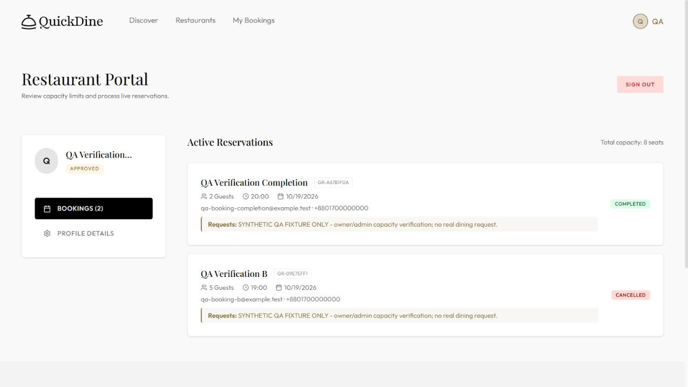

# QuickDine: deployment and evaluation supplement

Verified 18 October 2026, Asia/Dhaka. This supplement updates tasks 4 and 5 and
supersedes older statements that owner/admin browser checks and hosted timings
were unavailable. It does not establish genuine-user recruitment or adoption.

## Deployment and software baseline

- Frontend: https://quick-dine-jade.vercel.app/
- Express API: https://quickdine-api-d604.onrender.com/
- Readiness: https://quickdine-api-d604.onrender.com/health/ready
- Reviewed application commit: `e60f030a78851bdbfd0891c62a533e4aafe1100a` on main.
- Vercel production deployment: `dpl_DJSJyBqtsK5oCdJgMmV193r2anV5`, READY on that commit when inspected.
- [CI run 39046386549](https://github.com/ajshahria/Quick-Dine-/actions/runs/39046386549):
  both jobs passed and two coverage artifacts were published. Its logs show
  42/42 API tests and 47/47 frontend tests, 89/89 (100%). API line coverage is
  97.78%; frontend line coverage is 91.14%. These are CI results, not a new local rerun.

## Live owner/admin smoke test

The owner used a separate browser session from the administrator. Only the
explicitly labelled synthetic QA venue was modified. Its final status is
rejected/suspended; its two reservations are cancelled and completed, with zero
confirmed QA reservations. Fixture records remain for traceability and are
excluded from operational dataset counts. Account passwords and session tokens
are not included in the evidence.

| Check | Expected | Observed | Result |
|---|---|---|---|
| owner-submission | pending | Registration Pending Approval; 6 seats | Pass |
| pending-public-discovery | 0 matching restaurants | 0 Restaurants Available for exact QA name | Pass |
| admin-approval-and-public-discovery | approved and 1 matching public restaurant | APPROVED; 1 Restaurant Available | Pass |
| owner-capacity-update | 6 -> 8 seats persisted | Owner profile 8; fresh public availability 8 | Pass |
| competing-five-guest-bookings | only one of two five-guest submissions fits an eight-seat slot | B confirmed GR-09E7EFF1; owner lists exactly one confirmed booking; A not confirmed | Pass |
| overcapacity-rejection | five more guests rejected when three seats remain | Only 3 seats are available for this time slot | Pass |
| owner-protected-capacity-edit | capacity reduction below five confirmed guests rejected | Capacity cannot be lower than confirmed reservations | Pass |
| owner-admin-role-guards | owner denied admin dashboard and admin API | Access Denied UI; Access denied, admin role required API | Pass |
| owner-cancellation | confirmed reservation becomes cancelled | GR-09E7EFF1 CANCELLED; no complete/cancel controls | Pass |
| owner-cancellation-releases-capacity | 19:00 availability returns from 3 to 8 | 19:00 8 seats on 2026-10-19 | Pass |
| owner-completion | two-guest reservation becomes completed and controls disappear | GR-A67B1F0A COMPLETED; GR-09E7EFF1 CANCELLED | Pass |
| admin-suspension | QA restaurant hidden; owner sees rejection | Admin REJECTED; public No Restaurants Found; owner Registration Denied | Pass |
| admin-reapproval | public discovery and owner dashboard restored | 1 public restaurant; owner APPROVED with terminal booking history intact | Pass |
| owner-logout-revocation | owner dashboard and bookings API require login | Login to continue; Not authorized; please sign in | Pass |
| final-fixture-suspension | QA fixture rejected and hidden | Admin REJECTED; public 0 restaurants | Pass |
| owner-login-and-refresh | same QA account and suspended venue state restored after login and reload | QA owner session restored; Registration Denied for suspended QA venue | Pass |
| admin-analytics | updated totals and both terminal QA booking statuses visible | 11 venues; 9 total bookings; QA completion COMPLETED and QA cancellation CANCELLED | Pass |

Raw checks: [owner/admin smoke JSON](evidence/evaluation/owner-admin-smoke-2026-10-18.json).
The two competing forms were submitted together by the browser driver; precise
server-arrival simultaneity was not measured. Their persisted result and the
subsequent explicit overcapacity rejection support this experiment, not a proof
for every possible race. Automated transaction tests supply additional coverage.



## Existing hosted dataset and provenance

The data source is the configured deployed MongoDB Atlas database. The user
cannot identify which old records came from genuine customers versus seed/demo
activity. We therefore report actual persisted application records with unknown
provenance, and do not rename them as pilot participants.

After excluding explicit QA records, the audit contains **11
users, 10 restaurants and 5
bookings**: two confirmed and three cancelled. Stored booking creation timestamps
span 10–28 August 2026; that range is not a verified participant-observation period.
The final audit excluded 2 QA users,
1 QA restaurant and 4 QA bookings.
No personal contacts or user IDs are exported by the audit.

The provenance check found **3 identities matching the
committed seed script**, linked to **3 of the five
operational bookings**. Matching used exact seed email identities internally;
only aggregate counts are exported. The other records are unverified, not
automatically genuine customers. This strengthens the reason to keep any
genuine-user pilot claim open.

## Capacity correctness

The read-only audit independently summed persisted confirmed guest counts and
compared them with direct Render availability responses, without calling the
application's capacity helper. Across today and tomorrow, **110/110
operational restaurant slots matched (100% agreement)**.
There were **0 occupied operational slots** in this
future-date comparison: these results alone do not exercise subtraction from
nonzero allocations. The two historical confirmed slot groups were independently
audited and neither exceeded current capacity; public date validation prevents
claiming those old dates as live availability comparisons.

The separate deployed synthetic experiment supplied the missing occupied-slot
case: **20/20
QA slots matched**, including one occupied slot. Eight seats minus five confirmed
guests produced three available seats; a further party of five was rejected.
Owner cancellation released the five seats. A separate two-guest reservation was
completed through the owner UI. These are QA workflow results, not real-customer
booking/adoption statistics.

Evidence: [initial Atlas audit](evidence/evaluation/atlas-capacity-2026-10-18.json),
[occupied QA audit](evidence/evaluation/atlas-capacity-occupied-2026-10-18.json),
[final Atlas audit](evidence/evaluation/atlas-capacity-final-2026-10-18.json).

## Sustained hosted response-time measurements

Measurements ran from 2026-10-18T06:59:27.932Z to 2026-10-18T10:51:42.886Z (UTC; add six hours
for Asia/Dhaka). Each of three concurrency levels ran for five measured minutes,
after ten warm-up requests excluded from the percentiles. Each worker was paced
to at most one request/second; total configured concurrency never exceeded five.
The workload alternated cuisine discovery and availability, using both the Vercel
same-origin proxy and direct Render API against the eight existing approved
non-QA restaurant records. Complete response bodies were consumed and checked.

Accepted phase windows:

- 1 workers: 2026-10-18T06:59:36.631Z through last request 2026-10-18T07:04:36.315Z; 300.428 measured seconds.
- 3 workers: 2026-10-18T07:04:43.002Z through last request 2026-10-18T07:09:42.757Z; 300.256 measured seconds.
- 5 workers: 2026-10-18T10:46:42.424Z through last request 2026-10-18T10:51:42.333Z; 300.427 measured seconds.

The original five-worker attempt was interrupted on the measurement client:
four failed requests recorded roughly an hour each despite ten-second timeout
configuration. The cause was not independently diagnosed. That entire phase
(1,342 requests, four failures) is retained in
[the interrupted summary](evidence/evaluation/hosted-load-interrupted-2026-10-18.json)
and its [raw samples](evidence/evaluation/hosted-load-interrupted-2026-10-18.jsonl),
and excluded from the accepted table. The complete five-worker phase was rerun
later with a client-heartbeat guard. This interruption is not classified as a
measured server outage. Different run windows can have different network/host
conditions; the phases are not a single continuous 15-minute experiment.
An additional twenty-second restaurant-discovery timeout occurred before the
accepted repeat; it had no measured workload samples and is retained in
[its diagnostic record](evidence/evaluation/hosted-c5-discovery-timeout-2026-10-18.json).

**2633/2633 measured requests succeeded; 0 HTTP/schema/timeout errors.**
Percentiles include all completed measured attempts, including failures if any;
warm-up samples and the explicitly invalid timing attempt are reported separately.

| Workers | Measured seconds | Requests | Errors | Achieved requests/s | p50 ms | p95 ms | p99 ms |
|---:|---:|---:|---:|---:|---:|---:|---:|
| 1 | 300.428 | 298 | 0 | 0.992 | 702.82 | 780.73 | 980.02 |
| 3 | 300.256 | 892 | 0 | 2.971 | 697.98 | 763.82 | 965.13 |
| 5 | 300.427 | 1443 | 0 | 4.803 | 718.02 | 885.02 | 1906.92 |

| Workers | Target | Requests | Errors | p50 ms | p95 ms | p99 ms |
|---:|---|---:|---:|---:|---:|---:|
| 1 | vercel-proxy | 149 | 0 | 709.83 | 821.36 | 980.02 |
| 1 | direct-render | 149 | 0 | 701.5 | 767.69 | 810.27 |
| 3 | vercel-proxy | 446 | 0 | 700.72 | 783.78 | 1113 |
| 3 | direct-render | 446 | 0 | 678.58 | 747.03 | 768.29 |
| 5 | vercel-proxy | 722 | 0 | 716.63 | 923.17 | 1878.85 |
| 5 | direct-render | 721 | 0 | 718.85 | 791.45 | 2018.22 |

Environment: Windows, Node v24.12.0, 12th Gen Intel(R) Core(TM) i5-1235U,
7.7 GiB RAM, user computer in Asia/Dhaka, WAN requests to
Vercel and Render, with MongoDB Atlas behind the API. Measurements include client,
network, hosting and database time; they do not isolate server compute time.
Observed cache-control was no-store for all successful saved samples.

Raw evidence: [run summary](evidence/evaluation/hosted-load-2026-10-18.json),
[per-request samples](evidence/evaluation/hosted-load-2026-10-18.jsonl).
The accepted five-worker repeat is also retained in
[its own summary](evidence/evaluation/hosted-c5-repeat-2026-10-18.json).

## Reproduction

From server, using Node 24 and locked dependencies:

```powershell
npm ci
node scripts/hosted-evaluation.mjs
node --env-file=.env scripts/audit-hosted-capacity.mjs --require-cleanup
node scripts/build-verification-report.mjs
```

Optional printable export requires Python with ReportLab:
`python scripts/render-verification-report.py`. The PDF is written to
`output/pdf/QuickDine_Verification_Supplement_2026-10-18.pdf` at repository root.

The measurement and audit commands generate fresh timestamped files and refuse
to overwrite evidence. The report builder regenerates this historical supplement
from its committed 18 October input files; it does not silently substitute later
measurements. To reproduce the accepted historical summary from its source runs,
run `node scripts/assemble-hosted-results.mjs` before the report builder.

The hosted workload is public/read-only and needs no credentials. The database
audit requires the user's existing MONGODB_URI, connects with autoIndex/autoCreate
disabled, and contains no insert/update/delete operation. Replaying the browser
QA journey requires distinct owner/admin sessions and explicit Terms approval for
new accounts. Do not replay it against unrelated restaurant records. The report
builder verifies saved request counts, response outcomes and fixture cleanup
before generating this document. A later run must update dates and filenames
consistently rather than silently relabelling this historical record.

## Interpretation and limits

These are measured hosted timings and persisted-data consistency results, an
advance over the earlier synthetic local benchmark. They are not maximum
sustainable throughput, open-loop stress testing, long-term availability, or
proof of real-user effectiveness. There is one run per load level, a small
dataset, a paced read-only request mix, unknown customer provenance, and shared
live-system/client activity (including the separate QA verification). Initial
discovery/warm-up timings are retained separately; cold-start extremes and write
contention need dedicated controlled experiments. The larger originally proposed
1/5/10/20-user staging matrix with three repetitions has not been performed.

Task 4's owner/admin smoke gap is closed for the recorded flows. Task 5 now has
reproducible deployed-data capacity checks and sustained hosted measurements,
alongside the existing [literature review](LITERATURE_REVIEW.md) and its eight
future improvements. If the lecturer requires verified genuine-customer data,
that empirical requirement remains open until provenance or a consented pilot
is supplied; a synthetic fixture cannot satisfy it.
The [provenance record template](DATA_PROVENANCE_TEMPLATE.md) lists the factual
evidence needed to close that specific empirical gap.
