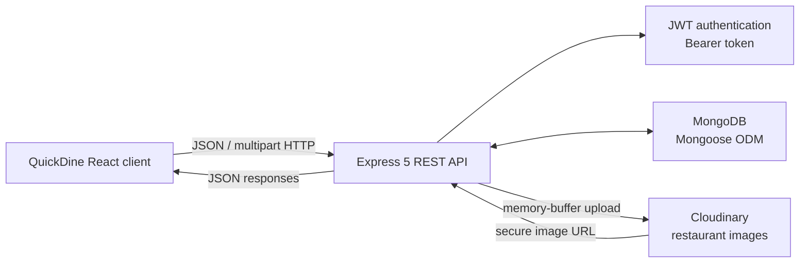
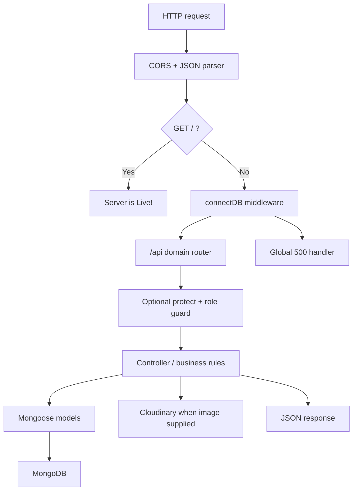
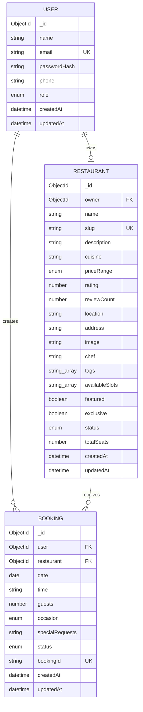
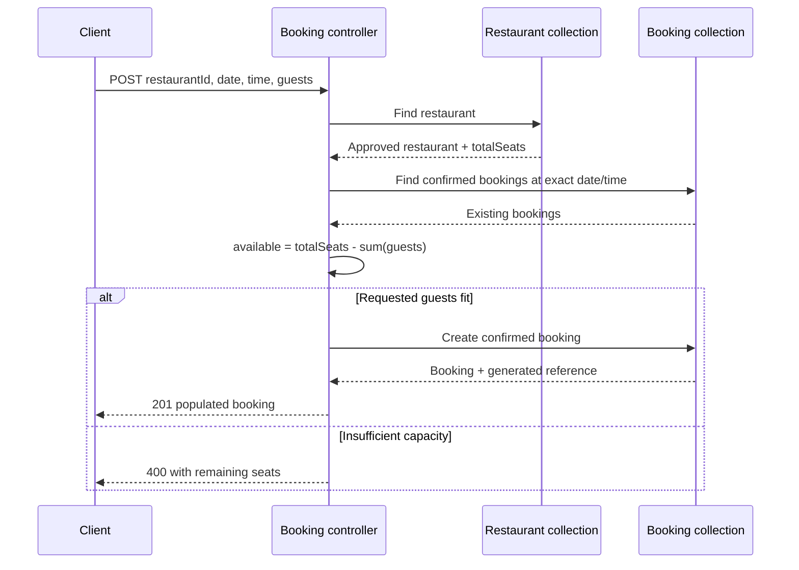
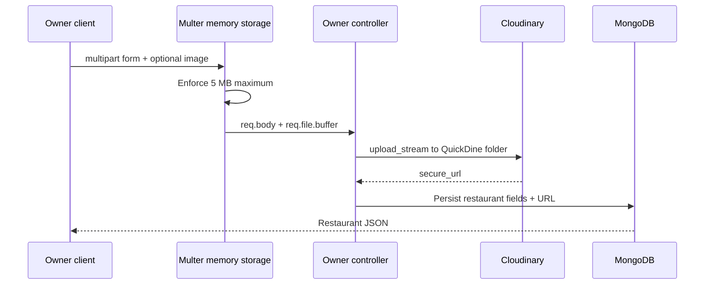

# QuickDine Server Architecture

## 1. Scope and status

This document describes the server as it exists in the repository. It was derived from a scan of all 23 files under `server/`, excluding generated dependency/build directories such as `node_modules/` and `dist/`. Source, configuration, environment-variable names, seed behavior, and lockfile metadata were included.

The server is a TypeScript Express REST API that provides authentication, approved restaurant discovery, seat availability, bookings, owner restaurant management, image upload, and administrative approval/statistics.

This is an as-is architecture reference. Risks and improvements are documented separately from current behavior.

## 2. System context



The API is stateless except for MongoDB data and a process-local cached MongoDB connection promise. JWTs carry the user identifier; user and role are reloaded from MongoDB for protected requests.

## 3. Runtime and deployment stack

| Concern | Technology | Responsibility |
|---|---|---|
| HTTP runtime | Express 5 | Routing, middleware, JSON responses |
| Language/runtime | TypeScript 6 on Node.js | Strict server source and ESM modules |
| Database | MongoDB with Mongoose 9 | Persistence, schemas, references, queries |
| Authentication | JSON Web Token + bcrypt | 30-day bearer tokens and password hashing |
| File intake | Multer memory storage | Single image buffer, maximum 5 MB |
| Image storage | Cloudinary | Upload owner restaurant images and return secure URLs |
| Configuration | dotenv / environment | Secrets and connection URLs |
| Development | tsx + nodemon | Direct TypeScript execution and reload |
| Build | TypeScript compiler | Emits ESM JavaScript to `dist/` |
| Hosting | Vercel-compatible exported app | Avoids `listen()` when `VERCEL` is present |

Required environment variables found by name are `MONGODB_URI`, `JWT_SECRET`, and `CLOUDINARY_URL`. `PORT`, `NODE_ENV`, and `VERCEL` are optional runtime controls referenced by the code.

## 4. Source organization

```text
server/
├── config/
│   ├── db.ts                  # Cached MongoDB connection establishment
│   └── multer.ts              # In-memory 5 MB upload middleware
├── controllers/
│   ├── authController.ts      # Register, login, current user
│   ├── restaurantController.ts# Public discovery, details, availability
│   ├── bookingController.ts   # Diner booking creation/list/cancellation
│   ├── ownerController.ts     # Owner restaurant/profile/image/bookings
│   └── adminController.ts     # Approval and aggregate metrics
├── middlewares/
│   └── auth.ts                # Bearer JWT, user lookup, role guards
├── models/
│   ├── User.ts                # User identity and roles
│   ├── Restaurant.ts          # Venue profile, approval, capacity, slots
│   └── Booking.ts             # Reservations and reference-code hook
├── routes/                    # Thin endpoint-to-controller declarations
├── seed.ts                    # Destructive development data reset/seed
├── server.ts                  # Express composition, DB gate, errors, export/listen
├── tsconfig.json              # Strict NodeNext compilation
├── vercel.json                # Vercel project marker/schema
└── package*.json              # Scripts and dependency lock
```

## 5. Layered request architecture



Responsibilities are divided as follows:

- `server.ts` composes process-wide middleware, routes, database readiness, and fallback error handling.
- route modules declare URL/method/guard/controller relationships.
- authentication middleware verifies JWTs, loads the user without the password, and checks roles.
- controllers perform validation, authorization tied to resource ownership, business calculations, queries, population, and response shaping.
- models define persistence validation, references, timestamps, and booking reference generation.
- configuration modules isolate database and upload initialization.

There is no separate service/repository/DTO-validation layer; controllers communicate directly with Mongoose and Cloudinary.

## 6. Request pipeline and authentication

1. `cors()` currently permits the package defaults for all origins.
2. `express.json()` parses JSON requests. Multipart owner routes are parsed later by Multer.
3. Every `/api` request passes through `connectDB()`. An established connection is reused; concurrent cold starts share `connectionPromise`.
4. `protect` expects `Authorization: Bearer <JWT>`, verifies it with `JWT_SECRET`, loads the user, removes the password field, and assigns `req.user`.
5. `adminOnly` requires `role === "admin"`.
6. `ownerOnly` accepts owners and administrators, although owner controllers still resolve resources through `owner === req.user._id`.
7. Controllers catch most errors themselves. Uncaught middleware/connection errors reach the global 500 handler; stack traces are suppressed in production.

Tokens contain only the user ID and expire after 30 days. Roles are not trusted from the token; they are loaded from the current user record on every protected request.

## 7. Endpoint catalog

All API endpoints are mounted below `/api`.

### Authentication

| Method and path | Guard | Controller behavior |
|---|---|---|
| `POST /auth/register` | Public | Validate required fields, normalize email, hash password, restrict self-selected role to diner/owner, return user + JWT |
| `POST /auth/login` | Public | Normalize email, compare bcrypt password, return user + JWT |
| `GET /auth/me` | JWT | Return the authenticated user without password |

### Restaurants

| Method and path | Guard | Controller behavior |
|---|---|---|
| `GET /restaurants` | Public | Return approved restaurants with search/price/rating/location/sort filters |
| `GET /restaurants/featured` | Public | Return up to six approved featured or exclusive restaurants |
| `GET /restaurants/:slug` | Public with optional JWT | Return approved restaurant; allow its owner/admin to see pending/rejected records |
| `GET /restaurants/:id/availability?date=` | Public | Compute confirmed booked seats and remaining capacity per configured slot |

### Diner bookings

| Method and path | Guard | Controller behavior |
|---|---|---|
| `POST /bookings` | JWT | Validate restaurant/status/capacity/occasion, create confirmed booking, populate restaurant summary |
| `GET /bookings/my` | JWT | Return current user's bookings with restaurant summary, newest date/time first |
| `PUT /bookings/:id/cancel` | JWT + booking ownership | Set booking status to cancelled |

### Owner portal

All routes use `protect` and `ownerOnly`.

| Method and path | Additional processing | Controller behavior |
|---|---|---|
| `GET /owner/restaurant` | None | Return the current owner's restaurant or `null` |
| `POST /owner/restaurant` | `upload.single("image")` | Enforce one restaurant, generate slug, upload optional image, parse lists, create pending venue |
| `PUT /owner/restaurant` | `upload.single("image")` | Update supplied profile/capacity/slot fields and optional image |
| `GET /owner/bookings` | None | Return bookings for the owner's restaurant with diner contact details |
| `PUT /owner/bookings/:id/status` | Booking ownership through restaurant | Set confirmed/cancelled/completed status |

### Administration

All routes use `protect` and `adminOnly`.

| Method and path | Controller behavior |
|---|---|
| `GET /admin/restaurants` | Return all restaurants with owner name/email/phone, newest first |
| `PUT /admin/restaurants/:id/approve` | Set pending/approved/rejected status |
| `GET /admin/stats` | Return diner/owner/restaurant/booking counts and ten latest populated bookings |

## 8. Data architecture



The one-user-to-zero-or-one-restaurant relationship is enforced by controller queries, not by a unique database index on `Restaurant.owner`. MongoDB references are populated selectively for the response use case.

### Entity rules

**User**

- unique normalized email;
- password minimum length is six at schema level and stored as a bcrypt hash by registration/seed paths;
- role is `user`, `owner`, or `admin`;
- password is removed during JSON serialization.

**Restaurant**

- unique lowercase slug;
- approval state is `pending`, `approved`, or `rejected`;
- price range is `$` through `$$$$`;
- contains global per-slot capacity through `totalSeats`, not table-level inventory;
- contains an image URL/path and optional curated `featured`/`exclusive` flags.

**Booking**

- belongs to one user and restaurant;
- status is `confirmed`, `cancelled`, or `completed`;
- occasion is restricted to the four values shared conceptually with the client;
- a pre-save hook creates a unique-looking `GR-XXXXXXXX` reference code;
- only confirmed bookings consume availability.

## 9. Capacity and booking flow



The public availability endpoint performs the same confirmed-seat aggregation for every configured restaurant slot. Cancellation and owner status changes release capacity by changing the status away from `confirmed`.

## 10. Owner image flow



Cloudinary configuration is discovered from `CLOUDINARY_URL`; there is no explicit configuration call in source.

## 11. Deployment and database lifecycle

- In a regular Node process, `server.ts` listens on `PORT` or 5000.
- On Vercel, the Express app is exported without opening a listener.
- The health route `/` responds before database middleware, so it only verifies the HTTP process/function.
- API calls trigger `connectDB()`; the module reuses an active Mongoose connection and caches an in-flight connection promise to reduce serverless reconnect storms.
- If an initial connection fails, the cached promise is cleared so a later request can retry.

## 12. Seed architecture and warning

`seed.ts` is a standalone data reset script, not part of the package scripts or server startup. It:

1. connects directly with `MONGODB_URI`;
2. deletes every user, restaurant, and booking;
3. creates fixed admin, diner, and owner accounts with hard-coded development passwords;
4. inserts approved sample restaurants owned by the same owner;
5. disconnects.

It is destructive and must only target an expendable development database. The current sample array also repeats the slug `terraza-cielo`; once the unique slug index exists, that can cause restaurant insertion to fail after the collections have already been cleared.

## 13. Client/server contract alignment

| Contract | Current alignment |
|---|---|
| Bearer JWT and `/auth/me` bootstrap | Aligned |
| Diner/owner/admin roles | Aligned |
| Restaurant/booking/status field names | Aligned |
| Occasion enum | Aligned |
| Repeated `priceRange` query fields | Aligned |
| Repeated `cuisine` query fields | **Not implemented by server** |
| Home search `date` and `guests` query fields | Sent by client but ignored by restaurant search |
| Text placeholder includes cuisine | Server searches name, tags, and location, but not cuisine |
| Booking contact form | Name/email/phone edits are not sent in the booking payload |
| Multipart owner create | Client contains a misspelled `Context-Type` header; browser/Axios inference may mask it |

## 14. Current architectural risks and recommended direction

1. **Make booking capacity atomic.** Availability checking and booking insertion are separate operations. Concurrent requests can both observe free seats and overbook. Use a transaction with an inventory/slot document, an atomic conditional update, or another concurrency-safe reservation design.
2. **Validate booking invariants.** Confirm the date is valid and not in the past, `guests` is a positive finite integer, the time belongs to `restaurant.availableSlots`, and the restaurant is approved in both availability and booking paths.
3. **Normalize date/time semantics.** Exact MongoDB `Date` equality depends on parsing/timezone behavior. Adopt an explicit service timezone and canonical local-date key, while storing time slots in a consistently validated format.
4. **Introduce request schemas and DTOs.** Controller-level ad hoc checks leave gaps and expose Mongoose documents directly. A validation layer should parse bodies/query parameters and a response layer should define stable public/admin/owner shapes.
5. **Align restaurant search.** Add the client-supported cuisine filter and decide whether date/guest availability belongs in search results. Include cuisine in text search if the UI promises it.
6. **Tighten security controls.** Restrict CORS to known client origins, validate required secrets at startup, add auth rate limiting, set upload MIME/type restrictions, and apply security headers and request-size limits.
7. **Clarify owner/admin authorization.** `ownerOnly` accepts admins, but owner controllers only operate on a restaurant whose owner equals the current user. Either make the guard owner-only or add explicit administrative resource selection. Correct the owner guard's admin-role error message.
8. **Separate transport, business, and persistence logic.** Controllers currently perform validation, authorization, calculations, Cloudinary calls, Mongoose queries, and response mapping. Domain services plus repositories/adapters would make capacity, approval, and image behavior testable.
9. **Use consistent error semantics.** Most caught database and programming errors become HTTP 400, while only uncaught errors become 500. Introduce typed application errors and a single error middleware.
10. **Preserve slug invariants on update.** Changing a restaurant name currently leaves the original slug. Either treat slug as intentionally stable or regenerate it with uniqueness checks.
11. **Enforce one restaurant per owner at the database level** if that remains a product rule; controller checks alone can race.
12. **Add indexes and pagination.** Define indexes around public status/featured queries and booking lookups by restaurant/date/time/status and user/date. Paginate admin restaurants, search results, and booking histories as data grows.
13. **Make seeding safe and repeatable.** Require an explicit non-production confirmation flag, remove duplicate slugs, avoid committed default credentials for shared environments, and expose a deliberate package script if needed.
14. **Add automated tests.** No test runner or tests are present. Highest-value coverage is auth/roles, pending restaurant visibility, capacity and concurrency, booking ownership, owner resource ownership, and approval transitions.

## 15. Recommended dependency rule

The current layers can evolve without changing the public API by enforcing this direction:

```text
Express routes and middleware
  ↓
validated request DTOs + controllers
  ↓
domain services and authorization policies
  ↓
repositories / Cloudinary adapter
  ↓
Mongoose models and external services
```

Routes should describe HTTP composition, controllers should translate HTTP to use cases, services should own booking/approval rules, and infrastructure adapters should own Mongoose and Cloudinary details.
